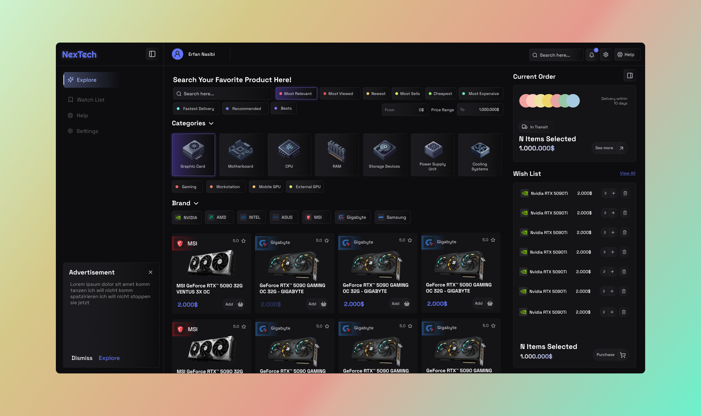

# NexTech



A full-stack e-commerce platform for computer hardware: a **Django REST Framework** API backed by **MySQL**, and a **React 19 + Vite + Tailwind CSS 4** single-page frontend with a separate seller/admin dashboard and a real-time support chat over WebSockets.

<p>
  
  
  
  
  
  
  
</p>

---

## Table of Contents

- [Features](#features)
- [Architecture](#architecture)
- [Tech Stack](#tech-stack)
- [Getting Started](#getting-started)
  - [Prerequisites](#prerequisites)
  - [1. Database](#1-database)
  - [2. Backend](#2-backend)
  - [3. Frontend](#3-frontend)
- [Running the Project](#running-the-project)
- [API Reference](#api-reference)
- [Authentication](#authentication)
- [Real-Time Chat](#real-time-chat)
- [Project Structure](#project-structure)
- [Database Schema](#database-schema)
- [Development Notes](#development-notes)
- [Troubleshooting](#troubleshooting)
- [Roadmap](#roadmap)
- [License](#license)

---

## Features

**Storefront**
- Product catalog with categories, specification details, image galleries and customer reviews
- Faceted search and filtering (category, price range, sorting) via `django-filter`
- Wishlist / basket that works for guests as well as signed-in customers
- Multi-shop model: the same product can be offered by several shops at different prices
- Checkout with standard and installment payment flows, plus shipping method selection

**Seller / Admin dashboard** (`/admin/dashboard/*`)
- Inventory management for a shop's products
- Order management with status transitions
- Discount code creation and management
- Finance overview with charts (Recharts)
- Shop settings

**Platform**
- Cookie-based JWT authentication with silent access-token refresh
- Real-time customer support chat over WebSockets (Django Channels)
- Dominant-color extraction endpoint used for adaptive product theming
- Django admin for direct data inspection

---

## Architecture

```
┌──────────────────────────────┐         ┌─────────────────────────────────┐
│  React 19 SPA (Vite :5173)   │         │  Django 5.2 + DRF  (:8000)      │
│                              │  HTTP   │                                 │
│  src/pages        storefront │ ──────► │  api/       auth + utilities    │
│  src/admin_pages  dashboard  │  JSON   │  users/     customers, admins   │
│  data/*.js        API client │ ◄────── │  products/  catalog             │
│  zustand          UI state   │         │  shops/     shops, discounts    │
│                              │   WS    │  orders/    orders, shipping    │
│  components/chat  support    │ ◄─────► │  payments/  payments, installm. │
└──────────────────────────────┘         │  chat/      Channels consumer   │
                                         └───────────────┬─────────────────┘
                                                         │ Django ORM
                                                         │ (unmanaged models)
                                                  ┌──────▼──────┐
                                                  │   MySQL 8   │
                                                  │ `onlineshop`│
                                                  └─────────────┘
```

> **Important:** every Django model in this project is declared `managed = False`. The database schema is **owned by the SQL files in `Backend/sql/`**, not by Django migrations. See [1. Database](#1-database) — running `makemigrations` / `migrate` against a fresh database is *not* the setup path and will fail.

---

## Tech Stack

| Layer | Technology |
|---|---|
| Backend | Django 5.2, Django REST Framework 3.16, django-filter, django-cors-headers |
| Real-time | Django Channels 4 (ASGI, in-memory channel layer) |
| Auth | PyJWT, access/refresh tokens delivered as HTTP-only cookies |
| Database | MySQL 8 via `mysqlclient`, schema managed by raw SQL |
| Frontend | React 19, React Router 7, Vite 6, Tailwind CSS 4, Zustand |
| UI | lucide-react, Swiper, Recharts, react-spinners, @smastrom/react-rating |

---

## Getting Started

### Prerequisites

- Python 3.10+
- Node.js 20+ (developed on 24) and npm
- MySQL 8 running locally
- Build tools for `mysqlclient` (Debian/Ubuntu: `sudo apt install python3-dev default-libmysqlclient-dev build-essential pkg-config`)

```bash
git clone <repository-url>
cd NexTech
```

### 1. Database

The schema **and** a full set of realistic sample data ship as a MySQL dump. Create the database and load it:

```bash
mysql -u root -p -e "CREATE DATABASE onlineshop CHARACTER SET utf8mb4 COLLATE utf8mb4_general_ci;"
mysql -u root -p onlineshop < "Backend/sql/final sql schema with data.sql"
```

Verify the load:

```bash
mysql -u root -p onlineshop -e "SELECT COUNT(*) FROM customer; SELECT COUNT(*) FROM product;"
```

You should see 57 customers and 8 products across 13 shops and 29 categories. The dump also contains Django's own tables (`django_migrations`, `auth_permission`, `django_content_type`, …) already populated, so Django considers all migrations applied and **you should not run `migrate`**.

Other files in `Backend/sql/`:

| File | Purpose |
|---|---|
| `final sql schema with data.sql` | **Use this.** Complete schema + sample data + Django tables |
| `database.sql` | Schema only (no data) |
| `fake_online_shop_data.sql` | Larger generated dataset |
| `remove_every_data.sql` | Truncates all domain tables, keeping the schema |

### 2. Backend

```bash
cd Backend
python3 -m venv venv
source venv/bin/activate          # Windows: venv\Scripts\activate
pip install -r requirements.txt
```

Database credentials live in `Backend/Backend/settings.py`. The defaults expect:

```python
DATABASES = {
    'default': {
        'ENGINE': 'django.db.backends.mysql',
        'NAME': 'onlineshop',
        'USER': 'root',
        'PASSWORD': 'root',
        'HOST': '127.0.0.1',
        'PORT': '3306',
    }
}
```

Adjust `USER` / `PASSWORD` to match your MySQL instance, then confirm the wiring:

```bash
python manage.py check
python manage.py shell -c "from users.models import Customer; print(Customer.objects.count())"
```

### 3. Frontend

```bash
cd Frontend
npm install
```

---

## Running the Project

Two processes, two terminals. **The backend must run on port 8000** — the frontend's API client and the Vite dev proxy both target it explicitly.

```bash
# Terminal 1 — API + WebSockets
cd Backend && source venv/bin/activate
python manage.py runserver 8000

# Terminal 2 — frontend
cd Frontend
npm run dev
```

| Surface | URL |
|---|---|
| Storefront | http://localhost:5173/ |
| Seller dashboard | http://localhost:5173/admin/dashboard/home |
| Support chat | http://localhost:5173/chat |
| API root | http://localhost:8000/products/ |
| Django admin | http://localhost:8000/admin/ |

Other frontend commands:

```bash
npm run build     # production bundle into dist/
npm run preview   # serve the built bundle
npm run lint      # ESLint
```

To sign in to Django admin you need a staff user. Because `Customer` is an unmanaged model with a custom `USERNAME_FIELD`, create one through the shell:

```bash
python manage.py shell -c "
from users.models import Customer
from django.utils import timezone
u = Customer.objects.create(emailaddress='admin@example.com', firstname='Admin', lastname='User',
                            isshopadmin=True, is_staff=True, is_superuser=True, createdat=timezone.now())
u.set_password('change-me'); u.save()"
```

---

## API Reference

All collection endpoints are DRF `ModelViewSet`s and support the standard `GET` / `POST` / `PUT` / `PATCH` / `DELETE` verbs, plus filtering via query parameters.

### Authentication & utilities — `/api/`

| Method | Endpoint | Description |
|---|---|---|
| `POST` | `/api/auth/login/` | Sign in; sets `access_token` + `refresh_token` cookies |
| `GET` | `/api/auth/me/` | Current customer from the access cookie |
| `POST` | `/api/auth/refresh/` | Rotate the access token using the refresh cookie |
| `POST` | `/api/auth/logout/` | Clear auth cookies |
| `GET` | `/api/dominant-color/?url=<image-url>` | Dominant color of an image, for adaptive theming |
| `POST` | `/users/auth/password/verify/` | Verify the current password (used before sensitive changes) |

### Catalog — `/products/`

| Endpoint | Resource |
|---|---|
| `/products/products/` | Products |
| `/products/categories/` | Categories |
| `/products/productCategory/` | Product ↔ category links |
| `/products/details/` | Specification rows |
| `/products/imageurlProduct/` | Product images |
| `/products/comment/` | Reviews and ratings |

### Shops — `/shops/`

| Endpoint | Resource |
|---|---|
| `/shops/shops/` | Shops |
| `/shops/shopProduct/` | Per-shop offers (price, stock) |
| `/shops/discounts/` | Discount codes |
| `/shops/shopAdmin/` | Shop ↔ admin links |

### Orders — `/orders/`

| Endpoint | Resource |
|---|---|
| `/orders/orders/` | Orders *(authentication required)* |
| `/orders/orderItems/` | Line items |
| `/orders/orderPayments/` | Order ↔ payment links |
| `/orders/shippings/` | Shipping methods |
| `/orders/orderShippings/` | Order ↔ shipping links |

### Payments — `/payments/`

| Endpoint | Resource |
|---|---|
| `/payments/payments/` | Payments |
| `/payments/installments/` | Installment plans |
| `/payments/installmentPayments/` | Installment instalments |

### Users — `/users/`

| Endpoint | Resource |
|---|---|
| `/users/customers/` | Customers |
| `/users/admins/` | Platform admins |

Each app's router exposes a browsable index — `GET /products/`, `GET /shops/`, `GET /orders/`, `GET /payments/`, `GET /users/` list their own endpoints.

**Example**

```bash
curl "http://localhost:8000/products/products/?category=1&ordering=-price"
```

---

## Authentication

`api.authentication.CookieJWTAuthentication` is the project-wide default authentication class.

1. `POST /api/auth/login/` validates credentials and returns a short-lived **access token** (15 min) and a **refresh token** (1 day) as HTTP-only cookies.
2. Every subsequent request carries the `access_token` cookie automatically; the class decodes it (HS256, signed with `SECRET_KEY`), checks `typ == "access"`, and resolves the `Customer`.
3. On a `401`, the frontend's `fetchWithAuth` helper (`Frontend/data/api.js`) transparently calls `/api/auth/refresh/` once and replays the original request.

Because tokens travel as cookies, the frontend sends `credentials: "include"` and the backend sets `CORS_ALLOW_CREDENTIALS = True` with `CORS_ALLOWED_ORIGINS = ["http://localhost:5173"]`. Add your own origin there when serving the frontend from anywhere else.

---

## Real-Time Chat

Support chat runs over Django Channels. `Backend/Backend/asgi.py` routes `ws/chat/` to `chat.consumers.ChatConsumer` behind `chat.middleware.JWTAuthMiddleware`, which authenticates the socket from the same JWT cookie.

The Vite dev server proxies `/ws` to the backend with `ws: true`, so `ws://localhost:5173/ws/chat/` reaches the consumer in development.

The channel layer is `InMemoryChannelLayer`, which is fine for a single development process but does not share state across workers. Swap in `channels_redis` before running more than one process.

---

## Project Structure

```
NexTech/
├── Backend/
│   ├── Backend/            # settings, root urls, asgi/wsgi
│   ├── api/                # auth views, JWT classes, utilities
│   ├── users/              # Customer (AUTH_USER_MODEL), Admins
│   ├── products/           # Category, Product, Details, Images, Comment
│   ├── shops/              # Shop, ShopProduct, Discount, ShopAdmin
│   ├── orders/             # Ordering, Orderitem, Shipping, …
│   ├── payments/           # Payment, Installment, Installmentpayment
│   ├── chat/               # Channels consumer, routing, JWT middleware
│   ├── sql/                # schema + seed data (source of truth)
│   ├── utils/              # fake data generator
│   ├── media/              # uploaded product images
│   ├── api_help.md         # endpoint cheatsheet
│   └── requirements.txt
├── Frontend/
│   ├── data/               # API client per domain (api, products, orders, …)
│   ├── src/
│   │   ├── pages/          # storefront: product, explore, order, wishlist, …
│   │   ├── admin_pages/    # dashboard: home, productM, orderM, discount, …
│   │   ├── components/     # header, cards, tables, inputs, chat, sidebars
│   │   ├── ui_storage.jsx  # Zustand store
│   │   └── main.jsx        # router
│   ├── vite.config.js      # dev server + API/WS proxy
│   └── package.json
├── todo.md
└── README.md
```

### Frontend routes

| Route | View |
|---|---|
| `/` | Storefront home |
| `/product/:id` | Product detail |
| `/explore` *(in-app)* | Search and filtering |
| `/wishlist` | Wishlist / basket |
| `/order` | Checkout and order history |
| `/settings` | Account settings |
| `/help` | Help page |
| `/form/:type` | `login` / `signup` forms |
| `/admin/dashboard/*` | Seller dashboard (guarded by `ProtectedAdminRoute`) |
| `/chat` | Support chat |

---

## Database Schema

26 tables. The domain core:

- **customer** — accounts; also the `AUTH_USER_MODEL`, with `isShopAdmin` marking sellers
- **product** → **details**, **imageurl_product**, **comment**, **productcategory** → **category** (self-referencing via `parentcategory`)
- **shop** → **shop_product** (price and stock per shop), **shopadmin**, **discount**
- **ordering** → **orderitem** (references `shop_product`), **payment**, **shipping**
- **installment** → **installmentpayment** for instalment plans
- **admins** — platform-level administrators

Django's `auth_*`, `django_*` and `customer_groups` / `customer_user_permissions` tables are included in the dump.

Because all models are unmanaged, **schema changes are made in SQL first**, then mirrored onto the model classes by hand (or regenerated with `python manage.py inspectdb`).

---

## Development Notes

- **Ports are not arbitrary.** `Frontend/data/*.js` hardcodes `http://127.0.0.1:8000`, so the backend must listen on 8000. Centralizing this behind a single `API_BASE` constant (or routing everything through the existing Vite proxy with relative URLs) is the natural next cleanup.
- **`DEBUG = True` and the `SECRET_KEY` are committed.** Both must be moved to environment variables, along with the database password, before any deployment. `ALLOWED_HOSTS` is currently empty.
- **`SIMPLE_JWT` in settings is inert** — `djangorestframework-simplejwt` is not installed and the project signs its own tokens with PyJWT. The block documents intent only.
- **Known warning:** `shops.Shop.shopname` is a unique `CharField` longer than 255 characters, which MySQL may reject on some configurations (`mysql.W003`).
- `python manage.py check` should report no issues; `npm run lint` currently reports unused-variable and `react-hooks/exhaustive-deps` warnings that are worth clearing but are not functional defects.

---

## Troubleshooting

| Symptom | Cause and fix |
|---|---|
| `django.db.utils.OperationalError: (1824, "Failed to open the referenced table 'customer'")` | You ran `migrate` against an empty database. The schema comes from the SQL dump — drop the database, recreate it, and load `Backend/sql/final sql schema with data.sql`. |
| `MySQLdb.OperationalError: (1050, "Table 'django_admin_log' already exists")` | A half-applied `migrate` left Django tables behind. Recreate the database and reload the dump, which drops and recreates every table. |
| `Access denied for user 'root'@'localhost'` | Update `USER` / `PASSWORD` in `Backend/Backend/settings.py` to match your MySQL instance. |
| `pip install mysqlclient` fails | Install the native build dependencies listed under [Prerequisites](#prerequisites). |
| API calls from the browser fail with CORS errors | The frontend origin must be listed in `CORS_ALLOWED_ORIGINS`, and the backend must be on port 8000. |
| Frontend loads but every request 404s | The backend is on the wrong port, or it isn't running. |
| Empty product lists | The database was created from `database.sql` (schema only). Load `final sql schema with data.sql` instead. |

---

## Roadmap

From `todo.md`:

- [ ] Define user roles and admin permissions properly
- [ ] Fix cookie timeout handling
- [ ] Verify discount application end to end
- [ ] Wire real data into the dashboard charts
- [ ] Complete admin settings
- [ ] Implement and correct brand images
- [ ] Add pagination
- [ ] Containerize with Docker

---

## License

See [LICENSE](./LICENSE).
